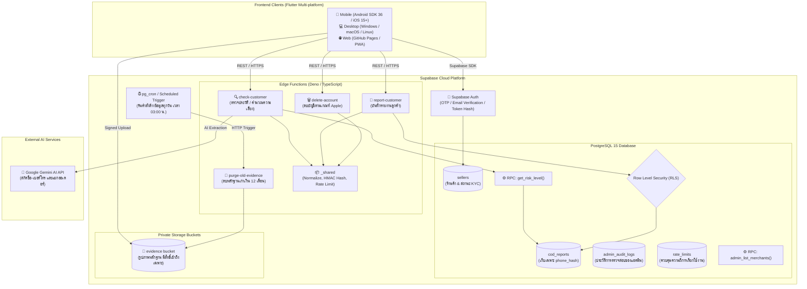

# 📦 COD Risk Shield (ระบบตรวจสอบประวัติและป้องกันความเสี่ยงลูกค้า COD)

[](https://3towson.github.io/low-code/)
[](https://flutter.dev)
[-3DDC84?style=for-the-badge&logo=android&logoColor=white)](https://developer.android.com)
[](https://supabase.com)
[](https://ai.google.dev)
[](https://deno.land)
[](docs/TEST_REPORT.md)
[](LICENSE)

> **แอปพลิเคชัน Multi-platform (Web, Android, iOS, Desktop) สำหรับร้านค้าออนไลน์รายย่อย เพื่อใช้ตรวจสอบความเสี่ยงของลูกค้าปลายทางแบบเก็บเงินปลายทาง (Cash on Delivery: COD) แจ้งเตือนประวัติการปฏิเสธรับสินค้าหรือพัสดุตีกลับ ช่วยลดต้นทุนค่าขนส่งและปกป้องธุรกิจจากออเดอร์แกล้งสั่ง พัฒนาตามมาตรฐานความปลอดภัยและความเป็นส่วนตัวสูงสุด สอดคล้องตามเกณฑ์ Apple App Store Review Guidelines, Google Play Data Safety และ พ.ร.บ. คุ้มครองข้อมูลส่วนบุคคล (PDPA)**

🌐 **ทดลองใช้งานจริง (Live Demo):** [https://3towson.github.io/low-code/](https://3towson.github.io/low-code/)  
⚖️ **พอร์ทัลคัดค้านข้อมูลสำหรับผู้บริโภค (Public Dispute Portal):** [https://3towson.github.io/low-code/dispute.html](https://3towson.github.io/low-code/dispute.html)

---

## 📑 สารบัญ
- [✨ ฟีเจอร์หลัก (Key Features)](#-ฟีเจอร์หลัก-key-features)
- [🚦 เกณฑ์การประเมินระดับความเสี่ยง (Risk Assessment)](#-เกณฑ์การประเมินระดับความเสี่ยง-risk-assessment)
- [🛡️ ความปลอดภัย ความเป็นส่วนตัว และ PDPA (Privacy & Security)](#️-ความปลอดภัย-ความเป็นส่วนตัว-และ-pdpa-privacy--security)
- [🏗️ สถาปัตยกรรมระบบ (System Architecture)](#️-สถาปัตยกรรมระบบ-system-architecture)
- [📁 โครงสร้างโปรเจกต์ (Project Structure)](#-โครงสร้างโปรเจกต์-project-structure)
- [🚀 การติดตั้งและเริ่มต้นใช้งาน (Getting Started)](#-การติดตั้งและเริ่มต้นใช้งาน-getting-started)
  - [1. ข้อกำหนดเบื้องต้น (Prerequisites)](#ข้อกำหนดเบื้องต้น-prerequisites)
  - [2. การตั้งค่า Environment Variables](#2-การตั้งค่า-environment-variables)
  - [3. การรันและการ Build Flutter App (Web / Android / Desktop)](#3-การรันและการ-build-flutter-app-web--android--desktop)
  - [4. การรันการทดสอบและ Edge Functions](#4-การรันการทดสอบและ-edge-functions)
- [🧪 การทดสอบและผลลัพธ์ (Testing & QA)](#-การทดสอบและผลลัพธ์-testing--qa)
- [📱 ความพร้อมสำหรับการปล่อยขึ้น Store (App Store & Google Play Readiness)](#-ความพร้อมสำหรับการปล่อยขึ้น-store-app-store--google-play-readiness)
- [🚢 การ Deploy ขึ้น GitHub Pages](#-การ-deploy-ขึ้น-github-pages)
- [📄 ใบอนุญาต (License)](#-ใบอนุญาต-license)

---

## ✨ ฟีเจอร์หลัก (Key Features)

### 1. 🔍 ระบบตรวจสอบความเสี่ยงลูกค้า COD (Customer Risk Check)
- รองรับทั้งการค้นหาด้วยเบอร์โทรศัพท์โดยตรง หรือ **วางข้อความออเดอร์ดิบ (Raw Order Text)** จากแชทลูกค้า
- **Smart Order Parser & Gemini AI Extract**: ตัดแบ่งหลายออเดอร์พร้อมกันอัตโนมัติ (Multi-order Splitting) และสกัดเบอร์โทรศัพท์ด้วย **Google Gemini AI API** พร้อมระบบตรวจจับเบอร์ด้วย Regular Expression แบบ Fallback ทันทีเมื่อออฟไลน์หรือ AI ไม่พร้อมใช้งาน
- แสดงผลระดับความเสี่ยงอย่างชัดเจน (**เขียว / เหลือง / แดง**) พร้อมคำแนะนำการจัดส่ง จำนวนครั้ง และช่วงเวลาที่เคยถูกรายงาน
- ใช้งานโหมดผู้เยี่ยมชม (Guest Mode) ได้ทันที (โควตาตรวจรวม 20 ครั้ง/วัน และ AI สกัดข้อความ 5 ครั้ง/วัน ต่อ IP รีเซ็ตเมื่อครบ 24 ชั่วโมง) พร้อมระบบ **Postgres Rate Limiting** ป้องกันการขูดข้อมูล (Scraping)

### 2. 🛡️ สถาปัตยกรรม Privacy-First ไร้การเก็บเบอร์โทรจริง (Zero Raw Phone Storage)
- **ไม่เก็บเบอร์โทรศัพท์จริงและชื่อลูกค้าลงฐานข้อมูลโดยเด็ดขาด** เพื่อสอดคล้องตามเกณฑ์ Apple Guideline 5.1.1(viii) และ PDPA
- เบอร์โทรจะถูก Normalize และแปลงเป็น **HMAC-SHA256 Cryptographic Hash** บน Supabase Edge Function โดยใช้ Secret Key ฝั่งเซิร์ฟเวอร์
- แสดงผลเบอร์โทรศัพท์ในรูปแบบ Masked เสมอ (เช่น `081-XXX-5678`)
- มี **Public Dispute Portal** ให้ผู้บริโภคทั่วไปสามารถยื่นคัดค้านหรือใช้สิทธิขอลบข้อมูล (Right to Erasure) ได้โดยไม่ต้องดาวน์โหลดแอป

### 3. 🏪 ระบบยืนยันตัวตนร้านค้า (Merchant KYC Verification)
- ป้องกันการรายงานเท็จและการกลั่นแกล้ง ร้านค้าต้องผ่านการตรวจสอบ KYC ก่อนได้รับสิทธิ์ส่งรายงานลูกค้า
- ข้อมูลการยื่น KYC: ลิงก์หน้าร้าน, หมวดหมู่สินค้า, เบอร์โทรศัพท์ติดต่อร้านค้า และ **หลักฐานยอดขาย/ส่งพัสดุจริงมากกว่า 50 ออเดอร์**
- ผู้ดูแลระบบ (Admin) ตรวจสอบและอนุมัติก่อนเปิดสิทธิ์รายงานพฤติกรรมลูกค้า

### 4. 📝 ระบบรายงานลูกค้าที่มีปัญหาพร้อมหลักฐาน (Problematic Customer Reporting)
- ฟอร์มรายงานระบุ: เบอร์โทร, แพลตฟอร์ม (Shopee, Lazada, TikTok, Facebook, LINE, อื่นๆ), สาเหตุความเสียหาย, มูลค่าความเสียหาย และรายละเอียด
- **บังคับแนบรูปภาพหลักฐานจริง (1–3 รูป)** จัดเก็บใน Supabase Storage Bucket แบบ Private พร้อม RLS เข้มงวด
- ระบบป้องกันการส่งรายงานซ้ำ (Anti-duplicate Reports) จากร้านเดียวกันภายใน 7 วัน
- รายงานเริ่มต้นที่สถานะ `pending` เพื่อให้แอดมินตรวจสอบความถูกต้องก่อนมีผลต่อระดับความเสี่ยง

### 5. 👮‍♂️ ระบบผู้ดูแลระบบและการดูแลความปลอดภัย UGC (Admin Moderation & UGC Safety)
- **Admin Dashboard**: ตรวจสอบและอนุมัติ/ปฏิเสธรายงานลูกค้า และคำขอยืนยันตัวตนร้านค้า (KYC)
- **ระบบระงับสิทธิ์ร้านค้า (Merchant Suspension)**: สั่งพักการใช้งานร้านค้าที่ส่งรายงานเท็จหรือละเมิดเงื่อนไข UGC พร้อมเพิกถอนเซสชัน (Revoke Session) ทันที
- **Anti-KYC Bypass**: จดจำสถานะเดิมของร้านค้า (`status_before_suspend`) เมื่อปลดระงับจะไม่สามารถข้ามขั้นตอน KYC ได้
- **Admin Audit Logs**: ตารางบันทึกประวัติการกระทำของแอดมินทุกขั้นตอน ตรวจสอบย้อนหลังได้อย่างโปร่งใส

### 6. 🧹 ระบบล้างข้อมูลและหลักฐานเก่าอัตโนมัติ (Automated Evidence Retention Purge)
- ฟังก์ชัน **`purge-old-evidence`** ทำงานผ่าน Scheduled Cron (pg_cron + pg_net ผ่าน Supabase Vault) รันทุกวันเวลา 03:00 น. เพื่อลบภาพหลักฐานที่เก่ากว่า 12 เดือน และลบแถว `cod_reports` ที่เก่ากว่า 24 เดือนโดยอัตโนมัติ สอดคล้องตามกฎหมาย PDPA และช่วยประหยัดพื้นที่จัดเก็บข้อมูล

### 7. 📱 ฟังก์ชันและมาตรฐานเพื่อการปล่อยขึ้น App Store & Google Play
- **ระบบลบบัญชีผู้ใช้ถาวร (Permanent Account Deletion)** ในแอปและ Edge Function สอดคล้องตามเกณฑ์ Apple Guideline 5.1.1(v) และ Google Play Data Safety
- **ระบบกู้คืนรหัสผ่าน 3 ขั้นตอน (Password Recovery Flow)**: ส่งอีเมล OTP 6 หลักสำหรับยืนยันการตั้งรหัสผ่านใหม่ทางอีเมลที่ลงทะเบียน พร้อมหน้า Landing Page (`reset-password.html`, `email-verified.html`)
- **Android Target SDK 36 (Android 16)** พร้อมการตั้งค่า Package Name `com.codcheck.app`, Release Keystore และการย่อ/Obfuscate โค้ดผ่าน R8 ตามค่าเริ่มต้นของ Flutter
- **Offline Font Bundling**: ฝังฟอนต์ `Prompt` ในแอป ทำงานได้สมบูรณ์แม้ไม่มีการเชื่อมต่อเครือข่ายภายนอก
- **Discard Confirmation Dialogs**: แจ้งเตือนยืนยันก่อนปิดหน้าจอเมื่อมีข้อมูลค้าง ป้องกันข้อมูลสูญหาย

### 8. 🎨 ดีไซน์ระดับพรีเมียม สองภาษา และรองรับทุกแพลตฟอร์ม (Bilingual & Multi-Theme)
- รองรับการสลับภาษาได้ทันที: **ภาษาไทย (TH)** และ **English (EN)**
- รองรับธีม **Dark Mode** และ **Light Mode** พร้อมปุ่มสลับธีมด่วนบน AppBar
- ออกแบบตามแนวคิด Material 3 ผสาน Modern Glassmorphism Responsive UI แสดงผลสวยงามทั้งบน Mobile, Tablet, Desktop และ Web

---

## 🚦 เกณฑ์การประเมินระดับความเสี่ยง (Risk Assessment)

ระบบคำนวณความเสี่ยงด้วย PostgreSQL Function (`get_risk_level`) บนฐานข้อมูล Supabase ตามเงื่อนไขที่รัดกุมและเป็นธรรม:

| ระดับความเสี่ยง | สัญลักษณ์ | เงื่อนไขการคำนวณ | คำแนะนำแก่ร้านค้า |
| :--- | :---: | :--- | :--- |
| **สีเขียว (Green)** | 🟢 | ไม่มีประวัติรายงานที่นับ (รายงานสถานะ `active` ภายใน 12 เดือนล่าสุด) | **"ส่งได้ตามปกติ"** |
| **สีเหลือง (Yellow)** | 🟡 | มีรายงานที่นับอย่างน้อย 1 ครั้ง แต่ยังไม่เข้าเกณฑ์สีแดง | **"ควรโทรหรือทักยืนยันออเดอร์กับลูกค้าก่อนแพ็กสินค้า"** |
| **สีแดง (Red)** | 🔴 | มีรายงานภายใน 90 วันล่าสุดจากร้านค้าต่างกันตั้งแต่ **2 ร้านขึ้นไป** โดยร้านค้าที่รายงานต้องมีอายุบัญชีไม่น้อยกว่า 7 วัน | **"ไม่แนะนำให้ส่งแบบเก็บเงินปลายทาง ควรให้ลูกค้าโอนชำระเงินก่อน"** |

### สาเหตุการรายงานที่รองรับ (Report Reasons)
- `refused_delivery`: ปฏิเสธรับสินค้า / พัสดุตีกลับ
- `unreachable`: ติดต่อไม่ได้ / ปิดเครื่อง / บล็อกเบอร์
- `fake_address`: ที่อยู่ปลอมหรือไม่ถูกต้อง
- `other`: อื่นๆ (สามารถระบุคำอธิบายเพิ่มเติมได้)

### แพลตฟอร์มที่รองรับ (Platforms)
- Shopee, Lazada, TikTok, Facebook, LINE, และ Other (อื่นๆ)

---

## 🛡️ ความปลอดภัย ความเป็นส่วนตัว และ PDPA (Privacy & Security)

```
[หมายเลขโทรศัพท์ลูกค้า]
         │
         ▼
[Edge Function: Normalize เบอร์โทร]  (แปลงเลขไทย, +66 -> 0, ตรวจ regex ^0[689]\d{8}$)
         │
         ▼
[HMAC-SHA256 + Server-side Secret]  (PHONE_HASH_SECRET อยู่บนเซิร์ฟเวอร์เท่านั้น)
         │
         ▼
  [phone_hash 64 chars] ───────────────► บันทึกลงตาราง cod_reports
         │
         ▼
[Masking สำหรับแสดงผล: 081-XXX-5678] ──► ส่งกลับแสดงผลบนหน้าบ้าน (ปลอดภัย 100%)
```

1. **การเข้ารหัสทางเดียว (One-Way Hashing)**: หมายเลขโทรศัพท์จะถูกแปลงเป็น `phone_hash` 64 ตัวอักษรด้วย HMAC-SHA256 ฝั่งไคลเอนต์ไม่มี Secret Key และไม่มีการบันทึกเบอร์โทรศัพท์จริงในฐานข้อมูล
2. **ไม่เก็บชื่อลูกค้า (Zero Customer Name Storage)**: ระบบไม่บันทึกชื่อลูกค้าปลายทางลงในตารางรายงาน (`customer_name` เป็น NULL เสมอ) เพื่อลดการเก็บข้อมูลส่วนบุคคลเกินความจำเป็น (Data Minimization)
3. **การควบคุมการเข้าถึง (Row Level Security - RLS)**: ตาราง `cod_reports` ถูกปิดกั้นการเข้าถึงโดยตรงจากฝั่ง Client การตรวจสอบและบันทึกรายงานต้องกระทำผ่าน Edge Functions ที่ผ่านการยืนยันตัวตนแล้วเท่านั้น
4. **การจำกัดอัตราการเรียกใช้งาน (Rate Limiting)**: ใช้ PostgreSQL Rate Limiting จำกัดจำนวนครั้งการตรวจสอบเบอร์โทรต่อนาที/ชั่วโมง ทั้งสำหรับ Guest (อิงตาม IP) และ User ร้านค้า
5. **นโยบายการทำลายข้อมูลตามอายุ (12-Month Retention)**: ข้อมูลและรูปภาพหลักฐานจะถูกลบถาวรเมื่อครบกำหนด 12 เดือนผ่านระบบ Automated Cron Job

---

## 🏗️ สถาปัตยกรรมระบบ (System Architecture)



---

## 📁 โครงสร้างโปรเจกต์ (Project Structure)

```text
├── app/                                # 📱 แอปพลิเคชัน Flutter (Multi-platform)
│   ├── android/                        # การตั้งค่า Android (Target SDK 36, Release Signing)
│   ├── ios/                            # การตั้งค่า iOS (Privacy Usage Descriptions)
│   ├── web/                            # การตั้งค่า Flutter Web และ Landing Pages
│   │   ├── email-verified.html         # หน้า Landing Page เมื่อยืนยันอีเมลสำเร็จ
│   │   └── reset-password.html         # หน้า Landing Page สำหรับตั้งรหัสผ่านใหม่ผ่าน Web
│   ├── assets/
│   │   ├── fonts/                      # ฟอนต์ Prompt สำหรับ Offline Bundling
│   │   └── icon/                       # ภาพไอคอนแอปพลิเคชัน (1024x1024 ไม่มี Alpha)
│   ├── lib/
│   │   ├── localization/               # ระบบ 2 ภาษา (Thai / English)
│   │   ├── pages/                      # หน้าจอทั้งหมดของแอปพลิเคชัน
│   │   │   ├── admin_dashboard_page.dart # แดชบอร์ดตรวจสอบ KYC & รายงานลูกค้าสำหรับแอดมิน
│   │   │   ├── home_page.dart          # หน้าหลักตรวจสอบความเสี่ยงลูกค้า
│   │   │   ├── login_page.dart         # หน้าเข้าสู่ระบบ
│   │   │   ├── report_customer_page.dart # หน้ารายงานลูกค้าพร้อมแนบหลักฐาน
│   │   │   ├── reset_password_page.dart  # หน้าขอกู้คืนรหัสผ่าน (3-Step Flow)
│   │   │   ├── set_new_password_page.dart# หน้าระบุรหัสผ่านใหม่
│   │   │   └── signup_page.dart        # หน้าลงทะเบียนร้านค้าใหม่
│   │   ├── services/                   # เลเยอร์เชื่อมต่อเซิร์ฟเวอร์
│   │   │   ├── admin_service.dart      # จัดการสิทธิ์แอดมินและการ Moderation
│   │   │   ├── app_settings.dart       # จัดการสถานะภาษาและธีมของแอป
│   │   │   ├── auth_service.dart       # ยืนยันตัวตน ล็อกอิน รีเซ็ตรหัสผ่าน ลบบัญชี
│   │   │   ├── check_service.dart      # เรียกตรวจประวัติลูกค้าผ่าน Edge Function
│   │   │   ├── evidence_storage_service.dart # อัปโหลดและจัดการภาพหลักฐาน
│   │   │   ├── merchant_kyc_service.dart# ส่งและตรวจสอบข้อมูล KYC ร้านค้า
│   │   │   └── report_service.dart     # ส่งรายงานพฤติกรรมลูกค้า
│   │   ├── utils/                      # เครื่องมือแยกออเดอร์และ Format ข้อความ
│   │   ├── widgets/                    # วิดเจ็ตที่ใช้ซ้ำในแอปพลิเคชัน
│   │   │   ├── check_panel.dart        # แผงช่องค้นหาและผลลัพธ์ระดับความเสี่ยง
│   │   │   ├── delete_account_dialog.dart # กล่องขอยืนยันการลบบัญชีผู้ใช้ถาวร
│   │   │   ├── merchant_kyc_dialog.dart# กล่องยื่นเอกสารยืนยันตัวตนร้านค้า
│   │   │   ├── settings_dialog.dart    # กล่องตั้งค่าภาษาและธีม
│   │   │   ├── error_banner.dart       # แถบแจ้งเตือนข้อผิดพลาด
│   │   │   └── page_body.dart          # เลย์เอาต์จัดกึ่งกลาง Responsive
│   │   ├── theme.dart                  # Modern Material 3 Light & Dark Theme Data
│   │   └── main.dart                   # จุดเริ่มต้นโปรแกรม
│   ├── test/                           # ชุดการทดสอบ Flutter Unit & Widget (244 tests)
│   └── pubspec.yaml                    # การกำหนด Dependencies และ Assets
│
├── supabase/                           # ⚡ Supabase Backend & Database
│   ├── migrations/                     # SQL Migrations (19 migrations: Schema, RLS, KYC, Cron, Audit)
│   └── functions/                      # Deno Edge Functions
│       ├── _shared/                    # Phone Normalizer, HMAC Hasher, Rate Limit, Period
│       ├── check-customer/             # ฟังก์ชันตรวจสอบประวัติลูกค้า (AI + Regex)
│       ├── report-customer/            # ฟังก์ชันรับรายงานลูกค้าพร้อมตรวจ KYC
│       ├── delete-account/             # ฟังก์ชันลบบัญชีผู้ใช้ถาวรตามเกณฑ์ Store
│       └── purge-old-evidence/         # ฟังก์ชันตั้งเวลาลบหลักฐานเก่าเกิน 12 เดือน
│
├── scripts/                            # 🛠️ สคริปต์ Deno, CI/CD และ Deployment
│   ├── check_setup.ts                  # ตรวจสอบการเชื่อมต่อ Supabase & Gemini
│   ├── seed_demo.ts                    # สคริปต์สร้างข้อมูลจำลองเพื่อการสาธิต
│   ├── seed_reviewer_accounts.ts       # สร้างบัญชีทดสอบสำหรับทีมงาน Apple / Google Review
│   ├── test_part1.ts - 7.ts            # ชุดทดสอบอัตโนมัติของระบบ Backend
│   ├── test_p0_1.ts / 4.ts / 6.ts      # ชุดทดสอบการลบบัญชี, UGC Moderation, Rate Limit
│   ├── e2e_test.ts                     # End-to-End Test เชื่อมต่อ Edge Functions จริง
│   └── deploy_web.ps1                  # สคริปต์สร้างและ Deploy Flutter Web สู่ GitHub Pages
│
└── docs/                               # 📚 เอกสารทางเทคนิคและคู่มือการปล่อยขึ้น Store
    ├── PROJECT_CONTEXT.md              # ขอบเขตและข้อกำหนดทางเทคนิคของระบบ
    ├── TEST_REPORT.md                  # รายงานสรุปผลการทดสอบทั้งหมดอย่างละเอียด
    ├── STORE_BUILD_GUIDE.md            # คู่มือการเตรียม Build AAB/IPA สำหรับ Store
    ├── STORE_PRIVACY_DATA_SAFETY.md    # รายละเอียดการตอบแบบสอบถาม Data Safety & Privacy
    ├── APPLE_REVIEW_NOTES.md           # ข้อมูลชี้แจงทีมงาน Apple Review (Guideline 5.1.1)
    ├── GOOGLE_PLAY_REVIEW_NOTES.md     # ข้อมูลชี้แจงทีมงาน Google Play Review
    └── STORE_READINESS_REVIEW_*.md     # บันทึกการรีวิวความพร้อมของสโตร์ในแต่ละรอบ
```

---

## 🚀 การติดตั้งและเริ่มต้นใช้งาน (Getting Started)

### ข้อกำหนดเบื้องต้น (Prerequisites)
- [Git](https://git-scm.com/)
- [Flutter SDK](https://flutter.dev/docs/get-started/install) (3.13 ขึ้นไป แนะนำ 3.24+)
- [Node.js](https://nodejs.org/) (v18+) หรือ [Deno](https://deno.land/) (v1.40+)
- บัญชี [Supabase](https://supabase.com/) และ [Google AI Studio](https://aistudio.google.com/)
- (สำหรับการทำ Build Android) JDK 17 และ Android SDK (Target API 36)

---

### 2. การตั้งค่า Environment Variables

คัดลอกไฟล์ตัวอย่าง `.env.example` เป็น `.env` ใน Root Directory:

```bash
cp .env.example .env
```

กรอกข้อมูลสำคัญใน `.env`:
```env
SUPABASE_PROJECT_REF=your_supabase_project_ref
SUPABASE_URL=https://your-project.supabase.co
SUPABASE_ANON_KEY=your_supabase_anon_key
SUPABASE_SERVICE_ROLE_KEY=your_supabase_service_role_key
GEMINI_API_KEY=your_gemini_api_key
GEMINI_MODEL=gemini-1.5-flash
TEST_USER_PASSWORD=YourSecurePassword123!
PHONE_HASH_SECRET=your_32_character_long_secret_hash_key
```

สำหรับฝั่ง **Flutter App** ให้สร้างไฟล์ `app/.env.flutter`:
```env
SUPABASE_URL=https://your-project.supabase.co
SUPABASE_ANON_KEY=your_supabase_anon_key
```

---

### 3. การรันและการ Build Flutter App (Web / Android / Desktop)

เข้าไปที่โฟลเดอร์ `app/` และติดตั้งแพ็กเกจ:

```bash
cd app
flutter pub get
```

#### 🌐 รันบน Web Browser (Chrome / Edge):
```bash
flutter run -d chrome --dart-define-from-file=.env.flutter
```

#### 📱 รันบน Android Device หรือ Emulator:
```bash
flutter run -d android --dart-define-from-file=.env.flutter
```

#### 💻 รันบน Windows Desktop:
```bash
flutter run -d windows --dart-define-from-file=.env.flutter
```

#### 📦 การคอมไพล์สำหรับนำส่ง Google Play (Android App Bundle - AAB):
1. สร้างไฟล์ Keystore และตั้งค่า [app/android/key.properties](app/android/key.properties) ตามคำแนะนำใน [docs/STORE_BUILD_GUIDE.md](docs/STORE_BUILD_GUIDE.md)
2. รันคำสั่งคอมไพล์:
```bash
cd app
flutter build appbundle --release --dart-define-from-file=.env.flutter
```
*(ไฟล์ `.aab` พร้อมอัปโหลดจะถูกสร้างไว้ที่ `app/build/app/outputs/bundle/release/app-release.aab`)*

---

### 4. การรันการทดสอบและ Edge Functions

#### ตรวจสอบความพร้อมของระบบและการเชื่อมต่อ Supabase & Gemini:
```bash
deno run --allow-net --allow-read --allow-env scripts/check_setup.ts
```

#### สร้างบัญชีทดสอบสำหรับ Reviewer (Store Review):
```bash
deno run --allow-net --allow-read --allow-env scripts/seed_reviewer_accounts.ts
```

#### รันการทดสอบ Unit Tests ของ Shared Functions (Phone & Period):
```bash
deno test supabase/functions/_shared/phone.test.ts
deno test supabase/functions/_shared/period.test.ts
```

#### รัน End-to-End Test ครบวงจร:
```bash
deno run --allow-net --allow-read --allow-env scripts/e2e_test.ts
```

---

## 🧪 การทดสอบและผลลัพธ์ (Testing & QA)

ระบบนี้พัฒนาด้วยกระบวนการ **Test-Driven Development (TDD)** ครอบคลุมการทดสอบทั้งส่วนฐานข้อมูล, Edge Functions, ความปลอดภัย และ User Interface:

- **Flutter Test Suite: 244/244 เคส ผ่าน 100%**
  ```bash
  cd app
  flutter test
  ```
- **Flutter Analyze: No issues found (ผ่านการตรวจ Lint สะอาด 100%)**
  ```bash
  cd app
  flutter analyze
  ```
- **Automated Backend Tests (Deno & PostgreSQL): 160+ เคส ผ่าน 100%** (ดูรายละเอียดใน [`docs/TEST_REPORT.md`](docs/TEST_REPORT.md))

| หมวดหมู่การทดสอบ | ขอบเขตการทดสอบ | ผลลัพธ์ |
| :--- | :--- | :---: |
| **Database & Schema** | Constraints, Verification Status, Platform, Amount checks, Audit Logs | ✅ ผ่าน 12/12 |
| **Security & RLS** | บล็อกไม่ให้ Client เข้าถึงตารางรายงานโดยตรง และป้องกันรายงานซ้ำภายใน 7 วัน | ✅ ผ่าน 9/9 |
| **Risk Engine** | คำนวณสี เขียว / เหลือง / แดง ตามช่วงเวลา 90 วันและ 12 เดือน | ✅ ผ่าน 10/10 |
| **Normalization & HMAC** | แปลงเลขไทย, รูปแบบ +66, HMAC-SHA256, และการ Mask เบอร์โทร | ✅ ผ่าน 21/21 |
| **AI Extraction & Regex** | การตัดแยกข้อความออเดอร์ด้วย Gemini AI และ Regex Fallback | ✅ ผ่าน 29/29 |
| **Edge Functions & Rate Limiting** | ทดสอบ `check-customer`, `report-customer`, `delete-account`, `purge-old-evidence` และ Rate Limit | ✅ ผ่าน 35/35 |
| **Merchant KYC & Moderation** | การยื่น KYC, แอดมินอนุมัติ/ปฏิเสธร้านค้า, การระงับร้านค้า และ Anti-KYC Bypass | ✅ ผ่าน 25/25 |
| **Account & Password Recovery** | การลบบัญชีผู้ใช้ถาวร, การกู้คืนรหัสผ่าน 3 ขั้นตอน, Deep Link Handling | ✅ ผ่าน 30/30 |
| **Flutter UI & Widgets** | CheckPanel, RiskCard, ReportForm, Settings, Localization, AdminDashboard | ✅ ผ่าน 246/246 |
| **End-to-End Flow** | ตรวจสอบวงจรจริง: สมัครร้านค้า -> KYC -> ตรวจสอบเบอร์ -> ส่งรายงาน -> ตรวจสอบซ้ำ | ✅ ผ่าน 12/12 |

---

## 📱 ความพร้อมสำหรับการปล่อยขึ้น Store (App Store & Google Play Readiness)

| รายการความพร้อม | มาตรฐานที่รองรับ | รายละเอียดการดำเนินงาน |
| :--- | :--- | :--- |
| **Apple Guideline 5.1.1(viii)** | Data Minimization | ไม่เก็บเบอร์โทรจริง ไม่เก็บชื่อลูกค้า ใช้ HMAC-SHA256 ด้วย Server Secret Key และ Mask ข้อมูลเสมอ |
| **Apple Guideline 5.1.1(v)** | Account Deletion | มีปุ่มลบบัญชีถาวรในแอป ทำงานผ่าน Edge Function ลบข้อมูลส่วนตัวและ Soft Delete ให้สถิติรวมยังถูกต้อง |
| **Apple Guideline 1.2** | UGC Safety | ร้านค้าต้องผ่าน KYC ก่อนรายงานได้, รายงานต้องผ่านการตรวจจากแอดมิน, มีระบบระงับร้านค้าที่ทำผิดกฎ |
| **Google Play Target SDK** | Target SDK 36 (Android 16) | ตั้งค่าใน `build.gradle.kts` ผ่านเกณฑ์บังคับของ Google Play ในปี 2026 เรียบร้อย |
| **Google Play Data Safety** | Data Safety Section | จัดทำเอกสารสรุปประเภทข้อมูลและการเข้ารหัสใน [docs/STORE_PRIVACY_DATA_SAFETY.md](docs/STORE_PRIVACY_DATA_SAFETY.md) |
| **Reviewer Credentials** | Demo Accounts | สคริปต์ `seed_reviewer_accounts.ts` จัดเตรียมบัญชีพร้อมทดสอบสำหรับทีมงาน Review |
| **Offline Performance** | Offline Font Bundling | ฝังฟอนต์ `Prompt` ในตัวแอป ใช้งานได้แม้อยู่ในพื้นที่สัญญาณอินเทอร์เน็ตจำกัด |

---

## 🚢 การ Deploy ขึ้น GitHub Pages

โปรเจกต์นี้มาพร้อมสคริปต์ PowerShell สำหรับคอมไพล์ Flutter Web และ Deploy ขึ้น GitHub Pages โดยอัตโนมัติ:

```powershell
./scripts/deploy_web.ps1
```

สคริปต์จะดำเนินการ:
1. Build Flutter Web ด้วย Flag `--base-href "/low-code/"` พร้อมโหลดค่าคอนฟิกจาก `.env.flutter`
2. อัปเดตและพุชไฟล์ Static ไปยัง Branch `gh-pages` บน GitHub
3. ใช้งานเว็บแอปได้ทันทีที่ [https://3towson.github.io/low-code/](https://3towson.github.io/low-code/)

---

## 📄 ใบอนุญาต (License)

โปรเจกต์นี้เผยแพร่ภายใต้ลิขสิทธิ์ [MIT License](LICENSE) สามารถนำไปศึกษา พัฒนาต่อยอด หรือประยุกต์ใช้งานได้อย่างเสรี
